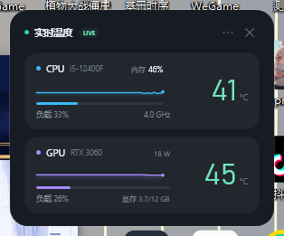
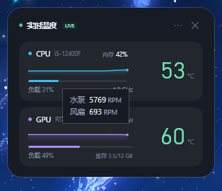
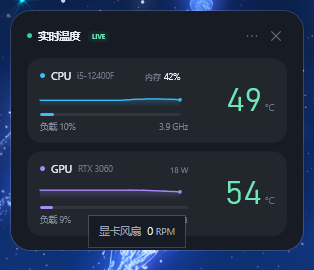
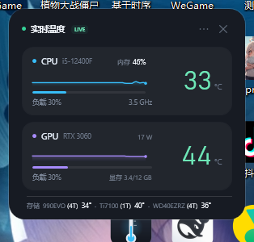

# DeskTemp · 桌面温度监控

> 不想看 Markdown？直接双击同目录的 **`README.html`**，图片已经内嵌，浏览器打开就能看；也可以用 VS Code / Typora 打开 `README.md`。

一个常驻桌面右上角的 Windows 小部件，实时显示 CPU 与显卡的温度、负载、频率/功耗和显存占用。



悬停 CPU 卡片左侧：



悬停 GPU 卡片左侧：



在 `···` 菜单勾选「显示硬盘温度」后：



## 使用

双击桌面上的 **「温度监控」** 快捷方式启动。

- 首次启动会弹出 **UAC**，请点「是」：读取 CPU 温度需要管理员权限。
- 若取消 UAC，程序仍可运行，但 CPU 温度会显示 `--`，此时只有显卡数据。
- 拖动卡片任意空白处可移动位置；位置会自动记住。
- 点右上角 `···` 或右键卡片：**始终置顶 / 锁定位置 / 显示硬盘温度 / 退出**。
- 点右上角 `×` 退出；托盘图标右键也可显示/隐藏或退出。
- 程序只在手动启动时运行，没有开机自启项。

## 数据

- 温度 / 负载每 1 秒刷新一次，风扇和主板传感器每 2 秒采样一次（温度曲线仍保留最近 60 个 1 秒采样点）。
- CPU：封装温度、总负载、平均核心频率；右上角显示系统内存占用百分比，悬停可看已用 / 总量（内存条本身没有可读温度）。
- GPU：核心温度、核心负载、功耗（卡片右上）、显存占用（卡片右下，小字直接显示）。
- 风扇转速改为悬停查看，不再常驻占一行：鼠标停在 CPU 卡片左侧（温度曲线/负载条区域）显示水泵（优先）和风扇转速；停在 GPU 卡片左侧显示显卡风扇转速。右侧大号温度区域不触发风扇提示。主板通道按本机实际存在的 SuperIO/主板传感器检测；名字里带 `Pump` 时直接识别为水泵，否则把明显高于机箱风扇的高转速通道标为水泵。同一张显卡的多路风扇合并成一个转速（取最高值）。未接风扇的空通道不显示，也没有固定通道数。
- CPU / GPU 型号自动读取并显示在名称右侧；过长的型号会省略号截断，鼠标悬停可看全名。
- 硬盘温度：**默认关闭**。在 `···` 菜单勾选「显示硬盘温度」后，底部会出现一行 `型号 (容量) 温度`；再点一次取消。型号和容量由 Windows 存储接口自动读取，不写死本机硬盘；未勾选时不查询、不占用高度。读取硬盘温度需要管理员权限。
- 内存条没有可读的温度传感器，因此不显示内存温度。
- 传感器来自 [LibreHardwareMonitor](https://github.com/LibreHardwareMonitor/LibreHardwareMonitor) 0.9.4（MPL-2.0）。读取主板风扇同样需要管理员权限；取消 UAC 时只显示显卡风扇。

## 资源占用

- 空闲时总 CPU 约 0.4–0.6%（按 12 个逻辑线程计）；温度/负载每秒采样，风扇/主板每 2 秒采样。
- 工作集约 180 MB，主要是 WPF 界面和 LibreHardwareMonitor 的传感器对象。
- 点托盘「隐藏窗口」后暂停传感器采样；重新显示后恢复，避免后台空转。

## 安装与卸载

运行 `dist\DeskTempSetup-1.0.0.exe`。

- 每用户安装到 `%LOCALAPPDATA%\Programs\DeskTemp`，**安装过程不需要管理员权限**；
- 安装时可选择是否创建桌面快捷方式；
- 仍会在每次启动 DeskTemp 时请求一次 UAC，用于读取 CPU/主板传感器；
- 卸载：Windows「设置 → 应用」里找到 DeskTemp，或运行安装目录下的 `unins000.exe`。

## 构建与打包

构建需要 .NET 10 SDK；生成安装包需要 Inno Setup 6/7 的 `ISCC.exe`。

```powershell
# 自包含发布：把 .NET 10 Desktop Runtime 一起打包，目标机器无需安装框架
dotnet publish -c Release -r win-x64 --self-contained true -p:PublishSingleFile=false -o dist\app

# 生成每用户安装包（安装不需要管理员）
ISCC.exe installer\DeskTemp.iss
```

安装包输出：`dist\DeskTempSetup-1.0.0.exe`。

> 当前为 .NET 10 自包含构建（.NET 10 LTS），目标机器无需安装 .NET。

预览模式（假数据，不需要管理员）：

```powershell
.\bin\Release\net10.0-windows\DeskTemp.exe --preview --no-elevate
```
